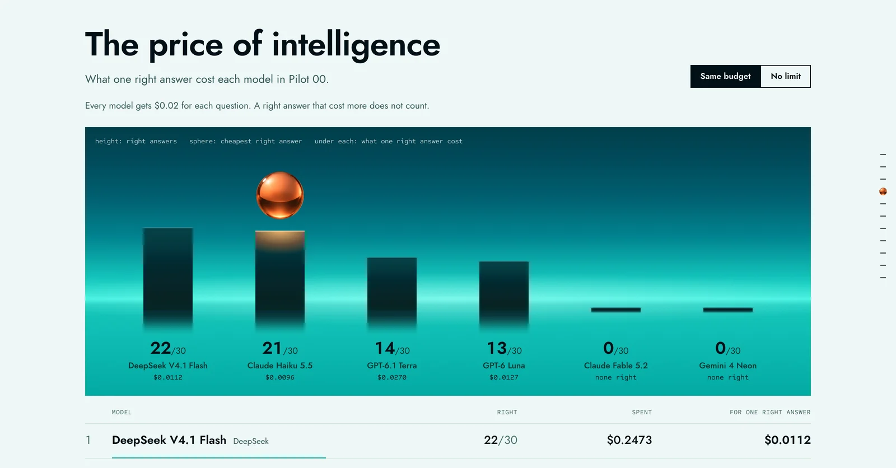
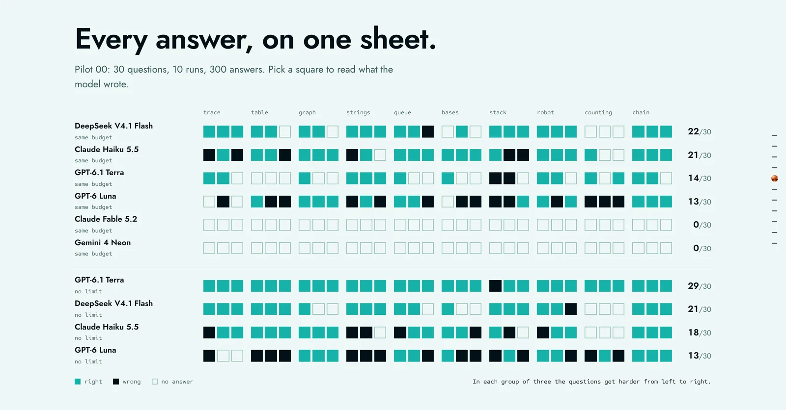
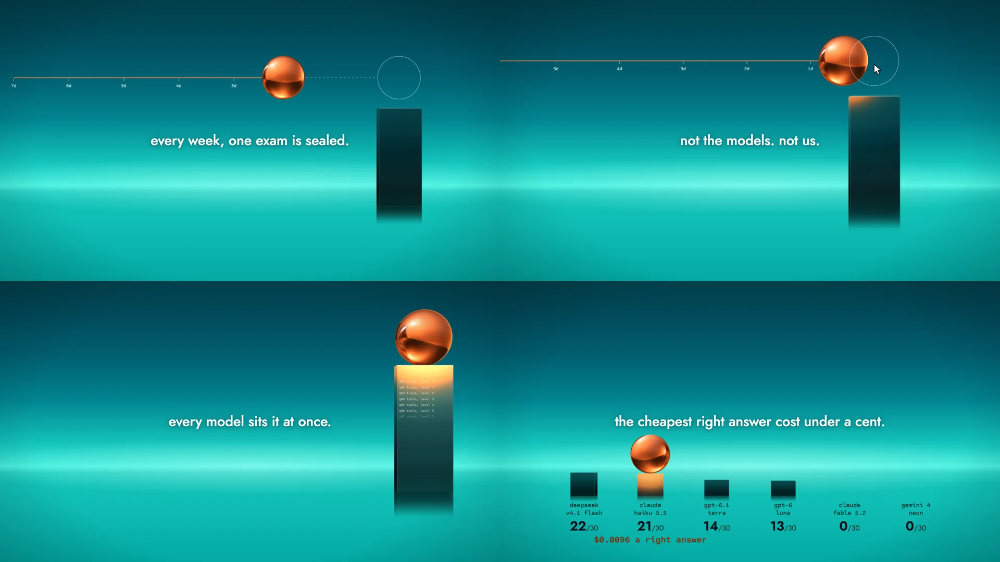

<a href="https://ignot.io"></a>

<p align="center">
  <a href="https://ignot.io">ignot.io</a> ·
  <a href="https://ignot.io/docs">docs</a> ·
  <a href="https://x.com/ignotexam">x</a> ·
  <a href="https://github.com/ignotio/ignot/actions/workflows/ci.yml"></a>
</p>

# ignot

An exam for AI models that is locked before any model can see it, opens by itself at a set time, and can be
checked by anyone afterwards.

- **Sealed.** The questions and their keys are encrypted to a future round of the [drand](https://drand.love)
  public randomness beacon. Until that round is published, nobody can decrypt them.
- **Fixed.** The manifest records the hash of the sealed file and the hash of the exam inside it before the exam
  opens. Changing one question afterwards changes the hash.
- **Re-derivable.** Every question is made by code in this repository from a seed that exists only inside the
  sealed file. After opening, anyone can make the exam again from the seed and compare it byte for byte.
- **Re-gradable.** Every model reply is stored. The verifier reads each reply again, grades it again and
  recomputes the scores and their Merkle root.

The engine is written in Rust. The same code runs in the command line and, compiled to WebAssembly, in the
browser of whoever opens the website.

## The price of intelligence

<a href="https://ignot.io/exam?id=pilot-00"></a>

Pilot 00 gave six models the same $0.02 for every question. A right answer that cost more does not count, so a
model that thinks at length can spend it all before it answers. Every reply and every mark is in
[`exams/pilot-00`](exams/pilot-00), and [the exam page](https://ignot.io/exam?id=pilot-00) grades them all again in
your browser.

<a href="https://ignot.io/exam?id=pilot-00"></a>

## One week



## Seal a file in three commands

```sh
git clone https://github.com/ignotio/ignot && cd ignot
cargo install --path crates/ignot-cli       # puts `ignot` on your PATH
ignot seal-file notes.txt --open +10m
ignot open-file notes.txt.age --out opened.txt     # refuses until 10 minutes have passed
```

`--open` takes a time (`2026-12-03T14:00:00Z`) or a delay (`+90m`, `+6h`, `+2d`). The `.age` file is an
[age](https://age-encryption.org) file with a [tlock](https://github.com/drand/tlock) recipient, the format of
drand's own tools, so they open it too.

## How an exam runs

```sh
ignot make --id 2026-w48                       # 30 questions from a random seed; the keys are in the file
ignot seal 2026-w48.plain.json --open +7d      # writes exams/2026-w48/{exam.age,manifest.json}, deletes the plain file
ignot open exams/2026-w48                      # after the round: writes exam.json
OPENROUTER_API_KEY=... ignot run exams/2026-w48 --models deepseek/deepseek-v4.1-flash,anthropic/claude-haiku-5.5
ignot verify exams/2026-w48
```

`run` asks every model every question on two tracks. Run it again to add models or a track to the same exam.

- **same-budget:** each model gets the same dollars per question (default $0.02). Cheap tokens buy longer
  thinking. A right answer that cost more than the budget does not count, and the runner makes sure that is
  never its own doing: the prompt is charged at the most it can cost, every token at the dearest price the model
  lists (some charge more at certain hours, and some hosts write long prompts to a cache unasked and bill that
  higher), and the request carries a price cap at that price, so prompt and answer together cannot pass the
  budget. When no host takes the request at that cap, because the cheapest one is busy, the cap is raised by
  half, up to three times, and the model is given the tokens the budget buys at the raised price: a busy host
  costs it some thinking, never the budget. A model that is billed more all the same is named at the end of the
  run.
- **unlimited:** each model thinks at high effort, with up to 32,000 output tokens.

Every request asks for the cheapest host that serves the model, and each answer records which host it was. Left
to itself the provider spreads requests over hosts that charge several times the listed price, and what an answer
cost would be a matter of luck.

An answer that was paid for is never asked for again. Each one is written to `run.partial.jsonl` in the exam's
folder the moment it arrives, so a run that is cut short loses nothing: run the same command again, and only
what is missing is asked for. The same goes for requests that failed: they count as not answered until the
same command asks them again. To ask a model again from scratch, remove its file from `answers/` first. One
run at a time works in a folder; a second one is refused while the first is under way.

A model that no request got through to is not saved as a model that got everything wrong: nothing of it is
saved, what was recorded for it before stays, and `run` exits with 1.

Each reply must end with a line `ANSWER: ...`. Grading is mechanical: numbers within 0.005, exact strings, or
lists of words. No model grades another.

There are ten kinds of question, each at five levels: tracing a program, filtering a table, cheapest routes
within a limit of steps, rewriting strings, a queue at a shop, arithmetic across number bases, a stack machine, a
robot on a grid, counting digits, and a chain where part 2 starts from the answer to part 1.

## What `verify` checks

For a sealed exam:

1. The sealed file has the hash in the manifest.
2. The exam's id on chain is the hash of its id.
3. The drand chain is quicknet.
4. The opening time in the manifest is the time of its drand round.
5. The sealed file is locked to that round and to no other.
6. The chain recorded this seal. The record contract accepts a seal only while its round is still ahead, and
   only a record in that contract counts: its address is part of the source, like drand's public key.
7. Nothing of the exam is published yet: no questions, no answers, no scores.

Once the round has passed:

8. The round's signature is drand's: it verifies against quicknet's public key, which is part of the source.
9. The sealed file opens with that signature.
10. The opened exam has the hash in the manifest, and the published `exam.json` is that exam.
11. The questions and keys regenerate, byte for byte, from the revealed seed. An exam that names another
    generator than this build's fails here: a build vouches only for what it can make again.
12. Every model answered every question once. A left-out wrong answer would make a model look cheaper.
13. Every reply grades to its stored mark.
14. The scores and the Merkle root recompute from the answers.
15. The chain recorded the recomputed root.

A check that cannot be made is reported as not made, with the reason; it is never counted as passed. Today
that is the case for 6 and 15: the record contract is not deployed yet, so no address is in the source.

Whether the round has passed is drand's to say, not the clock of the machine that checks. `verify` asks the
relays every time, and a signature that verifies settles it.

`verify` exits with 0 when no check failed, 1 when one did, 2 when it could not run.

## How the seal works

A sealed file is an age file. age encrypts the data under a fresh key; ignot wraps that key with identity-based
encryption on BLS12-381, where the identity is a drand round number and the private key for it is the signature
drand publishes at that round ([tlock, eprint 2023/189](https://eprint.iacr.org/2023/189)). Nobody holds that
signature early: it is produced by a threshold of the League of Entropy's nodes when the round arrives.

- The curve arithmetic is [arkworks](https://arkworks.rs). Files are read by the
  [age](https://github.com/str4d/rage) crate and written, with the timelock as their only recipient, by
  [`agefile.rs`](crates/ignot-core/src/agefile.rs); the wrapping itself is in
  [`timelock.rs`](crates/ignot-core/src/timelock.rs).
- A signature fetched from a relay is never trusted. It is verified against quicknet's public key before
  anything is opened ([`drand.rs`](crates/ignot-core/src/drand.rs)).
- Files sealed by drand's JavaScript tool open here, and files sealed here open there
  ([`tests/interop.rs`](crates/ignot-core/tests/interop.rs)).
- A seed has at least 32 characters (`make` draws 64 random hex digits). The manifest publishes a hash of the
  exam, so a short seed could be found by trying seeds until the hash fits.
- Money is counted in whole billionths of a dollar and everything that is hashed is written as JSON with sorted
  keys and whole numbers only, so the same data gives the same hash on every machine.

## Grade it again

```sh
cargo test --workspace -- --include-ignored     # the ignored test runs trace programs through python3
forge test --root contracts
```

- Every kind of question is solved again from its own text by separate code, next to the generator in
  [`crates/ignot-core/src/generate`](crates/ignot-core/src/generate). Trace programs are run by Python itself.
- The same seed always gives the same exam bytes ([`exam.rs`](crates/ignot-core/src/exam.rs)).
- A changed sealed file, a hand-edited question, a changed mark, a left-out answer, a forged root and a
  mismatching record on chain all fail verification ([`verify.rs`](crates/ignot-core/src/verify.rs)).
- A damaged or forged sealed file is refused, never misread: every flipped bit is caught
  ([`timelock.rs`](crates/ignot-core/src/timelock.rs)).
- The command line is tested from seed to checked results against a scripted clock, relay, node and model
  provider ([`commands.rs`](crates/ignot-cli/src/commands.rs)).
- The engine reads the events of the record contract as the contract's own source declares them, and counts
  drand rounds the way it does ([`chain.rs`](crates/ignot-core/src/chain.rs)).

## The site

```sh
cargo install wasm-bindgen-cli --version 0.2.130 --locked    # once
cd site && npm ci
npm run engine     # compiles the engine to WebAssembly into site/src/wasm
npm run dev        # the pages, built from the exam folders in this repository
npm run build      # static files in site/dist
```

The first screen is a clock: the copper sphere travels the week before an exam opens and reaches the monolith at
the open round. The pages make the checks themselves, in the browser, with the engine above: open a sealed
exam, seal a file of your own, and run the whole verifier on an exam. Nothing a reader seals or opens there is
sent anywhere.

The build also publishes the exam folders as they are under `/exams/`, with one index at `/api/exams.json`.

On the development server two query parameters help when working on the first screen:
`?at=2026-11-24T13:59:50Z` shows the page at another moment, and `?open=1.4` holds the opening at that many
seconds so one frame can be looked at. Neither exists in a build.

## Contracts

- [`ExamSeals.sol`](contracts/src/ExamSeals.sol): the sealer records an exam's hashes and drand round, which is
  only possible while that round is still ahead, and records the results root once, which is only possible after
  the round has opened. It holds no funds and cannot be upgraded.
- [`StumpBox.sol`](contracts/src/StumpBox.sol): anyone can add a question to an upcoming exam by burning a fixed
  amount of a token. The question arrives already sealed by its author. The burn goes straight from the sender to
  the dead address; the contract never holds tokens.

## Limits

- Sealing proves that the exam was fixed before it opened and was not changed after. It does not hide the
  questions from whoever made them.
- That a seal is older than its round is shown by the record on chain. Until the record contract is deployed,
  the history of this repository is the only witness, and `verify` says so instead of passing the check.
- The record on chain is read from a node of your choosing. A node that lies can lie about a receipt.
- A model that many hosts serve is asked at its cheapest host. Hosts may run the same model differently (some
  at a lower precision); each answer names the host that served it.
- A model that charges more at certain hours is given, on the same-budget track, the tokens its dearest hour
  buys, at every hour. The same holds for hosts that bill writing a prompt to their cache. A model whose cheapest
  host is busy is given the tokens of a raised price, which the answer's `maxTokens` shows.
- A model that searches the web on every request (the Sonar models, for one) is billed a fee per search that the
  price list does not tie to the request, so the runner cannot reserve it: such a model can pass the budget on
  the same-budget track, and the run says so. Keep such models off that track.
- Opening depends on the drand quicknet beacon being live.
- A model's output is not deterministic. Asking it again gives similar answers, not the same bytes; verification
  grades the stored replies.
- What a reply cost is what the provider reported. It is recorded and bound into the Merkle root, not re-derived.

## Layout

```
crates/ignot-core   the engine: questions, timelock, grading, scores, verification; reads no clock, file or network
crates/ignot-cli    the `ignot` command: files, drand relays, a chain node, the model provider
crates/ignot-wasm   the engine for browsers
site                the website; its pages run the engine in the reader's browser
contracts           ExamSeals and StumpBox, with Foundry tests
exams               sealed and opened exams
```

## License

MIT
